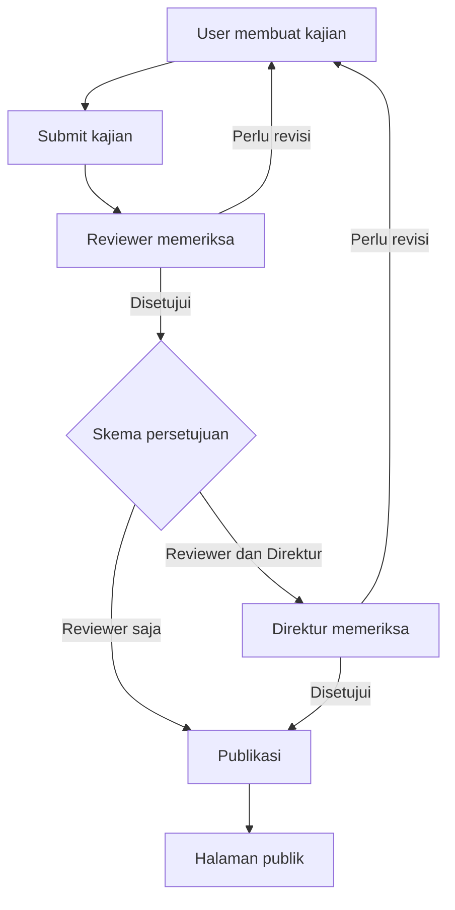
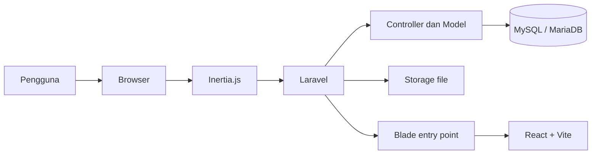

# Kajian Big Data BPS — Dokumentasi Project

> Platform web untuk pengelolaan dan publikasi kajian Big Data di Badan Pusat Statistik (BPS).

Aplikasi ini mendukung alur pengelolaan kajian mulai dari penulisan, pengajuan, review, persetujuan, hingga publikasi pada halaman publik.

---

## 1. Ringkasan

**Kajian Big Data BPS** merupakan platform untuk mengelola kajian Big Data secara terstruktur. Aplikasi menyediakan halaman publik untuk menemukan dan membaca kajian, serta dashboard internal untuk mengelola konten dan proses persetujuannya.

Peran pengguna:
- **Admin** — mengelola pengguna, kategori, dan kajian.
- **User / Penulis** — membuat, mengedit, dan mengajukan kajian.
- **Reviewer** — memeriksa kajian dan memberikan catatan review.
- **Direktur** — memeriksa hasil review dan memberikan persetujuan akhir.

### Alur utama kajian



---

## 2. Tech Stack

| Lapisan | Teknologi | Kegunaan |
|---|---|---|
| Backend | PHP | Bahasa pemrograman backend |
| Framework | Laravel 10 | Routing, controller, validasi, dan logika aplikasi |
| ORM | Eloquent ORM | Interaksi dengan database |
| Integrasi frontend | Inertia.js | Menghubungkan Laravel dengan halaman React |
| Frontend | React.js | Antarmuka pengguna |
| CSS | Tailwind CSS | Styling dan layout responsif |
| Rich text editor | Quill Editor | Penulisan konten kajian |
| Asset bundler | Vite | Development server dan production build |
| Database | MySQL / MariaDB | Penyimpanan data aplikasi |
| Package manager PHP | Composer | Pengelolaan dependency PHP |
| Package manager JavaScript | NPM | Pengelolaan dependency frontend |
| Version control | Git | Pengelolaan versi source code |
| Repository utama | GitLab | Repository project |
| Repository cadangan | GitHub | Backup source code |
| Local environment | Laragon | Menjalankan aplikasi secara lokal |

---

## 3. Fitur Aplikasi

### Halaman publik
- Beranda dan daftar kajian.
- Detail kajian.
- Pencarian kajian.
- Filter berdasarkan kategori dan halaman detail kategori.
- Metadata SEO dan structured data JSON-LD.
- Antarmuka Bahasa Indonesia dan Bahasa Inggris.

### User / Penulis
- Dashboard untuk memantau kajian.
- Membuat, mengedit, dan menghapus kajian.
- Mengunggah cover kajian.
- Menulis konten menggunakan rich text editor.
- Mengunggah gambar dan dokumen PDF.
- Gallery gambar.
- Embed video dan konten.
- Embed repository GitHub dan GitLab.
- Callout dan preview kajian.
- Memantau status kajian dan mengajukan permintaan penghapusan.

### Reviewer
- Melihat daftar kajian yang perlu ditinjau.
- Mengambil kajian untuk direview.
- Memberikan catatan review dan permintaan revisi.
- Menyetujui atau mengembalikan kajian untuk revisi.

### Direktur
- Melihat kajian yang menunggu persetujuan.
- Memeriksa hasil review.
- Menyetujui atau mengembalikan kajian untuk revisi.
- Mendukung alur persetujuan reviewer saja maupun reviewer dilanjutkan direktur.

### Admin
- Dashboard administrasi dan monitoring.
- Manajemen pengguna.
- Manajemen kategori.
- Manajemen kajian.

---

## 4. Arsitektur Aplikasi

Aplikasi menggunakan Laravel sebagai backend dan React sebagai frontend, dengan Inertia.js sebagai penghubung keduanya.



Secara umum:
- Laravel menangani route, autentikasi, validasi, logika bisnis, dan akses database.
- React menyediakan antarmuka interaktif untuk halaman publik dan dashboard.
- Inertia.js menghubungkan response Laravel dengan halaman React.
- Vite digunakan untuk development dan membangun aset frontend.
- File cover dan konten yang diunggah disimpan melalui Laravel Storage.

---

## 5. Struktur Direktori

Berikut gambaran direktori utama project. Beberapa direktori berisi file standar Laravel yang tidak ditampilkan seluruhnya.

```text
kajian-bigdataBPS/
├── app/
│   ├── Http/
│   │   ├── Controllers/
│   │   └── Middleware/
│   ├── Models/
│   ├── Policies/
│   ├── Providers/
│   └── Support/
├── bootstrap/
├── config/
├── database/
│   ├── factories/
│   ├── migrations/
│   └── seeders/
├── public/
│   ├── build/
│   └── images/
├── resources/
│   ├── css/
│   ├── js/
│   │   ├── Components/
│   │   ├── Contexts/
│   │   ├── Layouts/
│   │   ├── Pages/
│   │   ├── ssr.jsx
│   │   └── i18n.js
│   └── views/
├── routes/
├── storage/
│   └── app/
│       └── public/
│           ├── categories/
│           └── studies/
├── tests/
├── .env.example
├── artisan
├── composer.json
├── package.json
├── phpunit.xml
├── README.md
├── tailwind.config.js
└── vite.config.js
```

### Direktori penting

| Direktori / file | Fungsi |
|---|---|
| `app/Http/Controllers/` | Menangani request dan alur aplikasi |
| `app/Models/` | Model dan relasi database |
| `app/Policies/` | Aturan otorisasi |
| `app/Support/` | Komponen pendukung, termasuk pemrosesan konten |
| `database/migrations/` | Definisi perubahan struktur database |
| `database/seeders/` | Seeder data awal |
| `resources/js/Pages/` | Halaman React |
| `resources/js/Components/` | Komponen React yang digunakan kembali |
| `resources/js/Contexts/` | Context frontend |
| `resources/js/i18n.js` | Terjemahan antarmuka |
| `resources/views/` | Template Blade, termasuk entry point aplikasi |
| `storage/app/public/` | File unggahan aplikasi |

---

## 6. Alur Review dan Publikasi

Kajian dapat mengikuti salah satu dari dua skema persetujuan:

1. **Reviewer saja** — setelah reviewer menyetujui kajian, kajian dapat dipublikasikan.
2. **Reviewer dan direktur** — kajian yang disetujui reviewer diteruskan ke direktur. Publikasi dilakukan setelah direktur memberikan persetujuan.

Kajian juga dapat dikembalikan untuk revisi sesuai tahap pemeriksaan. Status kajian digunakan untuk membedakan kajian yang masih berupa draft, sedang ditinjau, menunggu persetujuan direktur, ditolak, atau telah dipublikasikan.

---

## 7. Database dan Storage

### Database

Aplikasi menggunakan database MySQL atau MariaDB. Nama database dan kredensial ditentukan melalui file `.env`.

Contoh konfigurasi:

```dotenv
DB_CONNECTION=mysql
DB_HOST=127.0.0.1
DB_PORT=3306
DB_DATABASE=kajian_bigdata_bps
DB_USERNAME=root
DB_PASSWORD=
```

Sesuaikan konfigurasi tersebut dengan environment yang digunakan. Jika project menggunakan nama koneksi khusus `mariadb` di `config/database.php`, gunakan nilai `DB_CONNECTION` yang sesuai dengan konfigurasi tersebut.

### Tabel utama

Aplikasi memiliki tabel untuk mengelola:
- Pengguna dan role.
- Kategori kajian.
- Kajian beserta status dan alur persetujuannya.
- Review kajian.
- Keyword dan relasi keyword dengan kajian.
- Views, likes, comments, dan shares.
- Permintaan penghapusan kajian.

Struktur database lengkap dikelola melalui migration pada `database/migrations/`.

### Storage

File yang diunggah disimpan di:

```text
storage/app/public/
├── categories/
└── studies/
    ├── content/
    └── covers/
```

Jalankan storage link agar file publik dapat diakses melalui direktori `public/storage`:

```bash
php artisan storage:link
```

Saat memindahkan atau melakukan deployment aplikasi, pastikan file yang dibutuhkan dari storage ikut dipulihkan atau dipindahkan.

---

## 8. Konfigurasi Environment

Buat file `.env` dari `.env.example`, kemudian sesuaikan konfigurasi aplikasi dan database.

Variabel database yang umum digunakan:

```dotenv
APP_NAME="Kajian Big Data BPS"
APP_ENV=local
APP_DEBUG=true
APP_URL=http://127.0.0.1:8000

DB_CONNECTION=mysql
DB_HOST=127.0.0.1
DB_PORT=3306
DB_DATABASE=kajian_bigdata_bps
DB_USERNAME=root
DB_PASSWORD=
```

`APP_KEY` dibuat menggunakan perintah `php artisan key:generate`. Jangan memasukkan file `.env`, password, atau nilai rahasia lainnya ke repository.

Untuk production, sesuaikan `APP_ENV`, `APP_DEBUG`, `APP_URL`, dan konfigurasi database dengan environment server.

---

## 9. Instalasi dan Menjalankan Project

### Persyaratan

Pastikan sudah tersedia:
- PHP 8.3 atau versi yang kompatibel dengan konfigurasi project.
- Composer.
- Node.js dan NPM.
- MySQL atau MariaDB.
- Git.

Laragon dapat digunakan sebagai lingkungan pengembangan lokal di Windows.

### 1. Clone repository

```bash
git clone <URL_REPOSITORY>
cd kajian-bigdataBPS
```

### 2. Install dependency

```bash
composer install
npm install
```

### 3. Siapkan environment

Windows PowerShell:

```powershell
Copy-Item .env.example .env
```

Linux / macOS:

```bash
cp .env.example .env
```

Isi konfigurasi `.env` sesuai database lokal.

### 4. Generate application key

```bash
php artisan key:generate
```

### 5. Siapkan database

Buat database terlebih dahulu. Jika tersedia dump SQL untuk database yang ingin dipulihkan, import dump tersebut ke database yang sesuai.

Jika memulai dari database kosong dan menggunakan migration:

```bash
php artisan migrate
```

> **Catatan:** Jangan menjalankan `php artisan migrate:fresh` pada database berisi data yang ingin dipertahankan karena perintah tersebut menghapus tabel sebelum membuatnya kembali.

### 6. Buat storage link

```bash
php artisan storage:link
```

### 7. Jalankan aplikasi

Jalankan perintah berikut di terminal terpisah.

Terminal pertama — Laravel:

```bash
php artisan serve
```

Terminal kedua — Vite:

```bash
npm run dev
```

Aplikasi lokal biasanya tersedia di:

```text
http://127.0.0.1:8000
```

---

## 10. Production Build dan Deployment

### Build frontend

Untuk membangun aset frontend:

```bash
npm run build
```

Hasil build disimpan di `public/build/`.

Jika konfigurasi SSR digunakan pada environment tertentu, jalankan proses build SSR sesuai konfigurasi project.

### Persiapan deployment

Sebelum menjalankan aplikasi di server:
- Pastikan source code dan dependency tersedia.
- Siapkan `.env` untuk environment production.
- Pastikan `APP_KEY` telah dikonfigurasi.
- Pastikan database dan kredensialnya benar.
- Pastikan direktori `storage/` dan `bootstrap/cache/` dapat ditulis oleh aplikasi.
- Pastikan file unggahan yang dibutuhkan tersedia.
- Buat storage link.
- Bersihkan cache konfigurasi jika diperlukan.
- Jalankan production build frontend.

Perintah yang dapat digunakan saat pembaruan deployment:

```bash
php artisan optimize:clear
npm run build
```

Aplikasi ini memiliki deployment production pada Railway. Detail environment dan kredensial deployment tidak disimpan di README.

---

## 11. Keamanan Konten

Konten kajian mendukung rich text editor dan berbagai jenis embed. Beberapa mekanisme keamanan yang tercakup dalam project:
- Konten HTML diproses menggunakan `StudyContentSanitizer`.
- Tag script, event handler berbahaya, URL berbahaya, dan iframe yang tidak diizinkan disaring.
- Preview draft menggunakan iframe sandbox.
- Structured data JSON-LD di-escape sebelum ditampilkan.

Tetap jaga kerahasiaan file environment, kredensial, dan data operasional. Perubahan pada pemrosesan HTML dan embed sebaiknya diuji sebelum diterapkan ke production.

---

## 12. Testing dan Perintah Laravel

### Menjalankan test

```bash
php artisan test
```

Untuk menjalankan test tertentu, misalnya:

```bash
php artisan test --filter=StudyContentSanitizerTest
```

### Perintah yang sering digunakan

```bash
php artisan optimize:clear
php artisan config:clear
php artisan route:clear
php artisan view:clear
php artisan storage:link
php artisan migrate
```

Gunakan perintah migrasi sesuai kondisi database. Pastikan backup tersedia sebelum menjalankan operasi yang dapat mengubah atau menghapus data.

---

## 13. Repository dan Pengembangan

Project dikelola menggunakan Git. Repository utama berada di GitLab, sedangkan GitHub digunakan sebagai repository cadangan.

Untuk memeriksa perubahan:

```bash
git status
```

Untuk menyimpan perubahan:

```bash
git add .
git commit -m "Deskripsi perubahan"
```

Untuk mengirim perubahan ke remote GitLab:

```bash
git push gitlab main
```

Pastikan remote yang digunakan benar sebelum melakukan push.

Project ini dikembangkan sebagai bagian dari kegiatan Magang Nasional di Badan Pusat Statistik (BPS), dengan fokus pada pengembangan platform web untuk pengelolaan dan publikasi kajian Big Data.

---

## 14. License

Project ini merupakan aplikasi untuk kebutuhan internal. Penggunaan dan distribusinya mengikuti kebijakan serta ketentuan yang berlaku di Badan Pusat Statistik.
